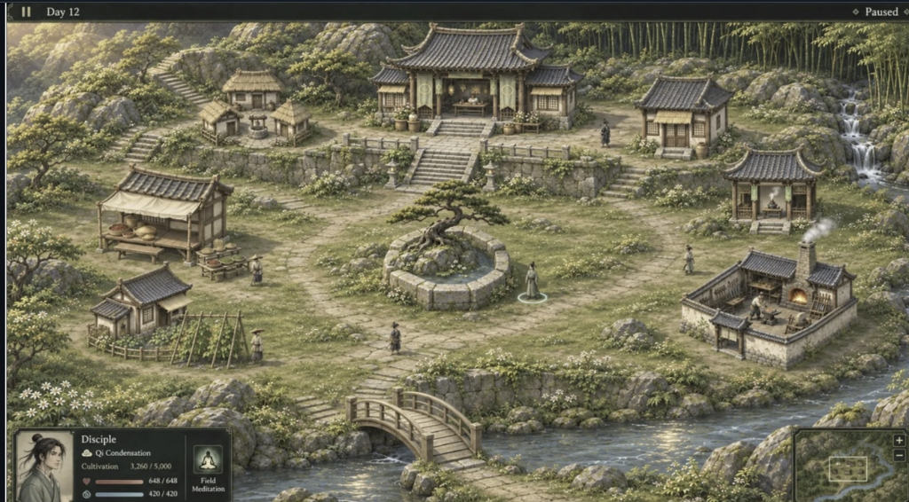
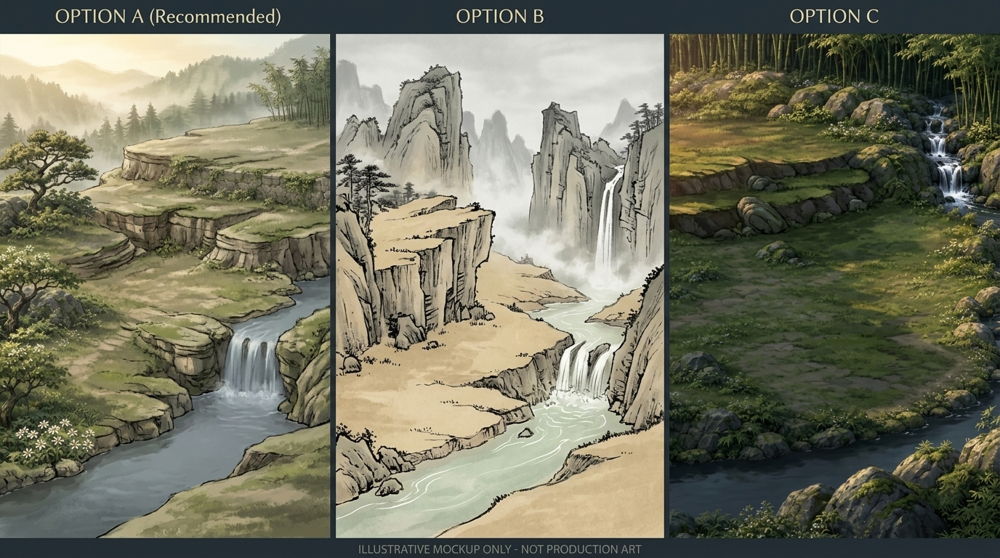
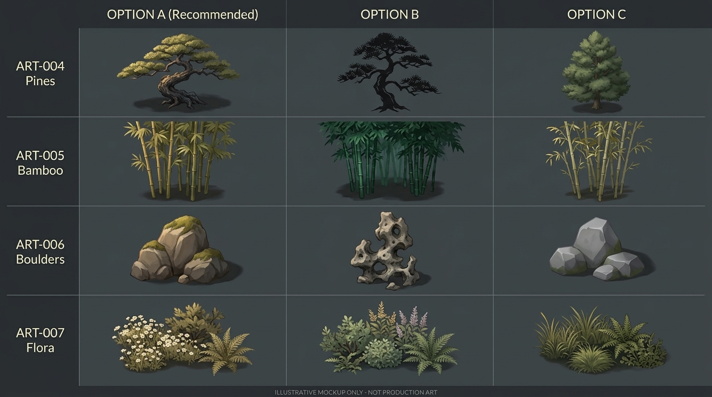
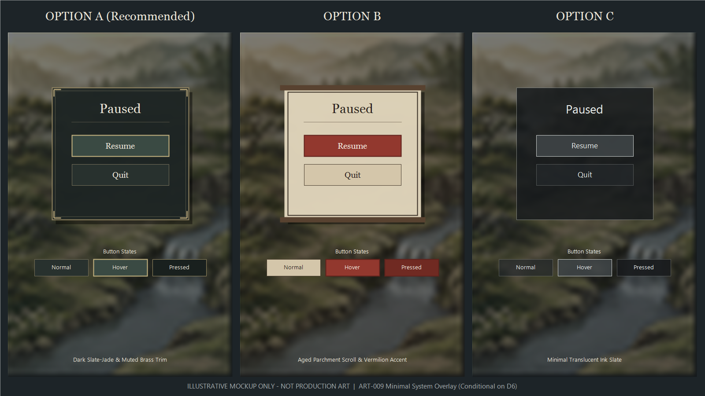
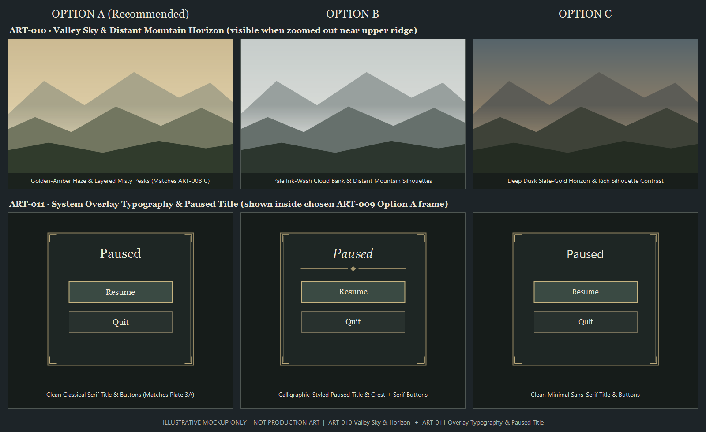

# Murim Life Game v0.1.0 · Mountain Valley World & Camera Exploration

**Status:** Approved

**Platform:** Windows (x64) · **Engine:** Unity · **Input:** Keyboard and mouse

**Release goal.** Explore a seed-deterministically generated, multi-level Chinese-wuxia mountain valley presented in strictly 2D painterly oblique art using keyboard and right-mouse panning and cursor-anchored zooming.

---

## Visual references (inspiration only, never shipped)

> The images below live in `docs/references/` for visual direction and art-option review only. They are **never** shipped or committed as runtime assets. Buildings, bridges, paths, characters, and gameplay HUD shown in the owner's visual reference are out of scope for `v0.1.0`.

### Owner Visual Reference

### Approved Option Comparison Plates (Illustrative Mockups Only)

- **Plate 1 (`ART-001`, `ART-002`, `ART-003`, `ART-008` — chosen: Option C):**

- **Plate 2 (`ART-004`, `ART-005`, `ART-006`, `ART-007` — chosen: Option A):**

- **Plate 3 (`ART-009` — chosen: Option A):**

- **Plate 4 (`ART-010`, `ART-011` — chosen: Option A for both):**

---

## Features

| ID | Feature |
|---|---|
| F-01 | **Seed-deterministic multi-level mountain valley.** Each normal launch generates an untouched, multi-tier mountain valley spanning roughly 2 to 3 screens across at widest overview zoom from a fresh random seed; a playtester can also supply a specific seed outside the game so launching twice with the same seed reproduces the exact same valley. Every generated valley guarantees three distinct elevation tiers (lower stream basin, mid-level meadows, upper shelves), one main mountain stream fed by one primary waterfall drop, front-facing rounded terraced earth-and-stone embankments, at least one gentle continuous slope visibly connecting each adjacent pair of tiers, varied mossy natural ground surfaces (no footpaths), and outer forested/rocky valley ridges opening onto a misty distant mountain horizon. |
| F-02 | **Natural Chinese-wuxia 2D flora, rocks, and ground dressing.** The generated valley is populated with static, strictly 2D painted classical Chinese-wuxia natural elements—gnarled mountain pines, sunlit bamboo groves, moss-capped boulders and outcrops, delicate white wildflowers, low muted shrubs, streamside ferns, and grass tussocks—anchored with soft 2D ground shadows and placed cohesively across tiers and banks. |
| F-03 | **Strictly 2D painterly presentation at a fixed oblique 3/4 view.** Every terrain surface, terraced embankment, slope, overhang lip, water body, natural prop, ground shadow, outer ridge, and horizon layer is rendered strictly as **2D painted art** (zero 3D models) in a cohesive Chinese-wuxia ink-and-earth aesthetic (with zero Korean Murim stylistic elements) from a fixed elevated 3/4 oblique perspective under warm late-afternoon upper-left golden sunlight. Elevation tiers step visibly upward on screen with consistent front-to-back depth sorting across ground position and tier height, maintaining a genuine multi-level elevation layout ready for future player-built structures, bridges, and vertical (XYZ) flying movement and selection. |
| F-04 | **Keyboard and right-mouse camera exploration.** The player opens centered on the heart of the valley at a balanced mid-overview zoom, pans across the valley via `WASD` / Arrow keys or right-mouse drag (with pan travel scaling to zoom so screen-space movement stays consistent), zooms continuously toward the cursor between close-up ground detail and wide valley overview via the mouse wheel, and returns to the default starting view with `Home` or `R`—with camera bounds clamped inside the valley, crisp 2D sprite layering across zoom levels, no camera rotation, no screen-edge scrolling, and no gameplay HUD. |
| F-05 | **Direct resizable-window launch and minimal system overlay.** Launching the game enters the playable valley directly in resizable windowed mode (supporting standard Windows resize, maximize, minimize, and close via the window close button or `Alt+F4`) with no title screen, settings menu, or save/load flow. Pressing `Esc` toggles a minimal dark slate-jade pause/quit overlay (`Paused`, `Resume`, and `Quit`) that blocks world camera inputs while open and allows clean exit to desktop. |

---

## Intent and feel

- **Secluded, living-ready Jianghu wilderness.** Entering the valley should feel like stepping into a hand-painted classical Chinese-wuxia mountain scroll—lush mossy turf, dark damp slate earth, mirror-dark mountain water pierced by crisp white waterfall streaks, sun-dappled bamboo ridges, warm late-afternoon golden light painted consistently from the upper left with grounded shadows under trees and boulders, and distant misty mountain peaks beneath a golden-amber sky beyond the upper ridge when zoomed out.
- **Unmistakable multi-level verticality in 2D.** Even in strictly 2D art with no camera rotation, all three elevation tiers—front-facing rounded earth-and-stone embankments, mossy overhang lips, gentle continuous slopes linking tiers, the vertical waterfall drop, and consistent front-to-back sprite sorting—must read immediately as layered height, laying an intuitive spatial foundation for future terraced buildings, bridges, and vertical flight/selection.
- **Grounded, composed camera motion.** Panning and zooming should feel continuous and unhurried with gentle damping rather than twitchy instant stops. Pan speed adapts naturally with zoom level, and zooming pulls toward wherever the player points their cursor so inspecting a distant ridge or waterfall drop feels effortless.
- **Readable across every zoom level.** Up close, painted brushwork on mossy boulders, gnarled pine needle pads, jointed bamboo culms, and tiny white wildflowers feels tactile and handcrafted without broken overlaps; zoomed out, terrain tiers, clearings, stream channels, and outer bamboo ridges compose cleanly with generous breathing room for future construction and disciples.

---

## Design principles

1. **Deterministic world first.** Every elevation shelf, slope, stream path, waterfall drop, rock outcrop, and grove is driven by a deterministic seed so re-launching with the same external seed reproduces the exact same valley, while normal launches generate fresh valleys from a random seed.
2. **Multi-level 2D elevation foundation.** All visuals are strictly 2D painted tiles, layers, and sprites (no 3D models), paired with genuine multi-level elevation tiers and vertical height tracking so the valley stays ready for future player-built terraces, bridges, and vertical (XYZ) unit movement and selection.
3. **Untamed wilderness before civilization.** `v0.1.0` generates untouched mountain geography with zero footpaths, roads, bridges, or buildings—leaving settlement and construction entirely to future player agency.
4. **Pure Chinese-wuxia painterly cohesion.** Rich verdant ground, dark mirror water, warm upper-left sunlight, and moss-capped natural props follow classical Chinese-wuxia / Jianghu traditions exclusively (never Korean Murim influences), avoiding harsh clutter or generic high-fantasy accents.
5. **Unobstructed exploration.** With no playable units or simulation HUD yet, the full viewport belongs to the mountain valley and camera feel.

---

## Controls

### While exploring

| ID | Input | Expected behavior |
|---|---|---|
| CE-1 | `W` / `A` / `S` / `D` or `Up` / `Left` / `Down` / `Right` arrow keys | Pans the camera continuously across the valley along screen-aligned horizontal directions while held, covering more ground when zoomed out and moving more finely when zoomed in so screen-space travel feels consistent, and easing gradually to rest with gentle damping on release without snapping or stuttering. Diagonal key combinations travel at the same perceived speed as cardinal panning. |
| CE-2 | Right-mouse button hold + drag | Drags the camera continuously across the valley in direct 1-to-1 response to pointer motion across all zoom levels without jumping or stuttering; releasing the right mouse button ends the drag and eases to rest with gentle damping. Middle-mouse drag has no effect. |
| CE-3 | Mouse scroll wheel up / down | Zooms continuously toward the world point beneath the cursor—moving inward toward close-up ground detail (scroll up) or outward toward a wide valley overview (scroll down) with gentle damping and no abrupt snaps—halting cleanly at the closest and widest zoom limits. |
| CE-4 | `Home` or `R` | Gradually eases the camera back to the default starting valley view (centered on the heart of the valley near the main meadow and stream basin, at a balanced mid-overview zoom) without an abrupt teleport or snap. |
| CE-5 | `Esc` | Opens the minimal system overlay displaying the `Paused` title, `Resume`, and `Quit`, pausing camera input while keeping the valley visible behind it. |

### While system overlay is open

| ID | Input | Expected behavior |
|---|---|---|
| CS-1 | `Esc` or left-click `Resume` | Closes the system overlay and immediately restores camera exploration. |
| CS-2 | Left-click `Quit` | Exits the game cleanly to the Windows desktop. |

### Window and OS controls (anytime)

| ID | Input | Expected behavior |
|---|---|---|
| CW-1 | Window close button (`X`) or `Alt+F4` | Exits the game cleanly to the Windows desktop whether exploring or viewing the system overlay. |
| CW-2 | Window border drag, maximize, or minimize | Resizes, maximizes, or minimizes the window cleanly without crashing or breaking camera bounds. |

---

## Edge cases

| ID | Situation | What the player experiences |
|---|---|---|
| EC-1 | Holding opposite pan keys simultaneously (e.g., `A` and `D`, or `W` and `S`) | Opposing inputs cancel cleanly so the camera holds steady on that axis without jitter, while perpendicular pan keys continue working normally. |
| EC-2 | Pressing keyboard pan keys while actively right-mouse dragging | Camera motion remains predictable without compounding speeds or sudden jumps; releasing either input transitions cleanly to the remaining active input or settles to rest. |
| EC-3 | Panning or zooming out near any playable valley boundary | Camera position clamps directly along the valley border without bouncing or jittering so empty void outside the generated world is never visible, even when zooming out to overview near an edge. |
| EC-4 | Scrolling past the closest or widest zoom limit | Zoom halts cleanly at the limit without bouncing, overshooting, flipping orientation, or altering the fixed oblique 2D view. |
| EC-5 | Zooming in closely over dense pine canopies, rounded embankments, overhang lips, or waterfall cascades | All 2D painted terrain tiles and prop sprites remain crisp and maintain consistent front-to-back draw order by ground position and elevation tier, with no flickering, popping, or foreground objects drawing behind background terrain or props. |
| EC-6 | Resting or moving the pointer along any edge of the game window | Nothing happens—screen-edge scrolling is disabled, so window borders never trigger unintended camera panning. |
| EC-7 | Window loses focus (`Alt-Tab`) or pointer leaves the window while panning/right-dragging | All active pan and drag inputs stop cleanly; when focus returns, the camera is stationary with no stuck movement or runaway drift. |
| EC-8 | Resizing or maximizing the game window, or changing display aspect ratio | The camera remains clamped within valley bounds with no empty void exposed, and the `Esc` system overlay (when open) remains centered and legible. |
| EC-9 | Clicking, right-dragging, scrolling, or pressing movement keys while the `Esc` overlay is open | World camera inputs are blocked behind the overlay; only the overlay buttons (`Resume`, `Quit`), `Esc`, and standard window controls respond. |
| EC-10 | Launching twice with the same external seed, versus launching twice normally | Supplying the same seed outside the game reproduces the exact same three-tier valley, slopes, embankments, stream, waterfall, and flora/rock placement; two normal launches with no seed override generate different valid valleys. |
| EC-11 | Pressing `Home` or `R` while actively panning or zooming | The reset immediately takes over from the active pan or zoom and gradually eases the camera back to the default starting valley view. |
| EC-12 | Pressing any pan key, right-dragging, or scrolling while a `Home`/`R` reset is still easing | The reset immediately cancels and hands camera control straight back to the player without snapping or jumping. |
| EC-13 | Left-clicking anywhere in the world while exploring | Nothing happens—no camera motion, ground marker, selection ring, or audio occurs. |
| EC-14 | Minimizing the game window while holding pan keys or right-dragging, then restoring it | Minimizing cancels all active pan and drag inputs cleanly; restoring the window resumes at the same camera position with no drift, stuck input, or visual distortion. |

---

## Art requirements

All `v0.1.0` art assets are **New** and **strictly 2D painted art** (zero 3D models; no production art is currently committed). Every item's visual direction below was selected by the owner from text descriptions and illustrative comparison mockups (never shipped as runtime assets), with consistent upper-left golden late-afternoon lighting painted directly into the 2D art.

| ID | Item | Purpose · features | Variants (count) | Disposition | Direction |
|---|---|---|---|---|---|
| ART-001 | Valley Ground Terrain Surfaces | Untouched multi-level 2D valley ground cover and bank surfaces · F-01, F-03 | 4 2D ground surfaces (verdant moss meadow turf, damp dark-slate mountain soil, mossy natural mountain stone floor, damp streamside pebble bank) | New | C · Rich Verdant Moss & Wet Slate Earth (2D) |
| ART-002 | Multi-Level Embankments & Natural Slopes | 2D front-facing elevation drops, overhang lips, and gentle slopes separating height tiers · F-01, F-03 | 4 2D elevation forms (rounded grassy terraced embankment, earth-and-boulder retaining bank, mossy cliff-edge overhang lip sprite, gentle continuous grassy/rocky hillside slope) | New | C · Rounded Terraced Earth-and-Stone Banks (2D) |
| ART-003 | Static Mountain Stream & Waterfall Surfaces | 2D valley stream basin and vertical waterfall cascade · F-01, F-03 | 3 2D water elements (dark reflective stream surface, subtle pale rocky bank edge, static crisp white waterfall cascade & plunge-pool foam) | New | C · Dark Mirror Pool & Crisp White Waterfall (2D) |
| ART-004 | Mountain Pine Trees | Iconic Chinese-wuxia 2D mountain pine sprites across ridges and clearings · F-02, F-03 | 4 2D tree sprites (1 ancient gnarled focal pine, 1 tall mature mountain pine, 1 leaning cliffside pine, 1 compact young hillside pine) | New | A · Layered Painterly Cloud-Canopy Pines (2D) |
| ART-005 | Bamboo Grove Clusters | Dense classical 2D bamboo cluster sprites for hillsides and grove borders · F-02, F-03 | 3 2D cluster sprites (dense tall grove cluster, medium grove-edge cluster, sparse young bamboo clump) | New | A · Sunlit Olive-Jade Vertical Groves (2D) |
| ART-006 | Mossy Boulders & Rock Outcrops | Grounded 2D mountain stone sprites along streams, banks, and hillsides · F-02, F-03 | 5 2D rock sprites (large cliffside outcrop, medium mossy boulder, flat streamside river stone, ridged hillside rock, small scattered stone cluster) | New | A · Moss-Capped Warm Slate Boulders (2D) |
| ART-007 | Wildflowers, Shrubs & Ground Foliage | Restrained 2D low flora sprites adding natural scale along banks and meadows · F-02, F-03 | 4 2D flora sprites (cream-white wildflower patch, low muted olive mountain shrub, streamside fern/reed tuft, mountain grass tussock) | New | A · Delicate White Wildflowers & Muted Mountain Brush (2D) |
| ART-008 | Valley Border Framing, Ground Shadows & Atmospheric Mood | 2D outer ridge enclosure, cast prop shadow sprite, and late-afternoon warm atmospheric overlay · F-01, F-02, F-03 | 3 2D atmosphere elements (close forested bamboo/rocky outer valley ridge framing, 1 reusable soft 2D cast ground shadow sprite, warm low-angle golden-amber atmospheric tint & subtle distance haze overlay) | New | C · Golden Late-Afternoon Valley Glow, Ground Shadows & Close Ridge Framing (2D) |
| ART-009 | Minimal System Overlay Frame & Buttons | Clean `Esc` pause/quit dialog panel and 3-state button skins · F-05 | 4 UI elements (1 centered dark slate-jade translucent panel frame with muted brass corner trim & divider; 1 standard action button skin in 3 states: normal, hover, pressed) | New | A · Dark Slate-Jade Frame with Muted Brass Trim |
| ART-010 | Valley Sky & Distant Mountain Horizon | 2D painted sky and layered distant peaks visible past the upper outer ridge when zoomed out · F-01, F-03 | 2 2D horizon elements (distant valley sky gradient, layered misty mountain-peak backdrop behind outer ridges) | New | A · Golden-Amber Haze & Layered Misty Peaks (2D) |
| ART-011 | System Overlay Typography & Paused Title | Licensed UI typeface and `Paused` header treatment for the `Esc` overlay · F-05 | 2 typography elements (1 licensed UI typeface used for overlay headings and buttons; 1 `Paused` title treatment with clean hairline divider) | New | A · Clean Classical Serif Title & Buttons |

---

### ART-001 · Valley Ground Terrain Surfaces

- **Variants (4):** (1) Deep emerald-moss meadow turf, (2) damp dark-slate mountain soil, (3) mossy natural mountain stone floor, (4) damp streamside gravel and pebble bank. Untouched wilderness only—no dirt footpaths or man-made paving.
- **Direction:** **Option C · Rich Verdant Moss & Wet Slate Earth (2D).** Strictly 2D painted seamless ground tiles with deep mossy greens and darker damp slate-brown earth, painterly brushwork, and organic blending across elevation shelves.
- **Visual requirements:** Must blend seamlessly across procedural multi-level shelves without visible repeating square tile patterns at overview zoom; painterly brushwork stays crisp up close; harmonious base for `ART-004`–`ART-007` sprites and future structures.
- **Acceptance:** Release checks 1 and 2 pass; all 4 2D ground variants render cleanly with no footpaths and no distracting repeating tile patterns across zoom levels.

### ART-002 · Multi-Level Embankments & Natural Slopes

- **Variants (4):** (1) Front-facing 2D rounded grassy terraced embankment wall, (2) front-facing 2D earth-and-embedded-boulder retaining bank, (3) 2D painted mossy cliff-edge overhang lip sprite, (4) angled 2D painted gentle continuous grassy/rocky hillside slope visibly connecting elevation tiers.
- **Direction:** **Option C · Rounded Terraced Earth-and-Stone Banks (2D).** Strictly 2D painted softly rounded grassy embankments punctuated by embedded boulders, mossy upper lips, and gentle continuous slopes visibly linking every adjacent pair of tiers under upper-left warm lighting.
- **Visual requirements:** Elevation steps must read unmistakably as multi-level height in the fixed oblique 3/4 2D view; overhang lips and embankments sort cleanly in front of lower ground and behind upper-tier props; embedded stones harmonize with `ART-006` boulders.
- **Acceptance:** Release checks 1 and 2 pass; both front-facing terraced embankments and gentle continuous slopes visibly connecting tiers read clearly at close-up and overview zoom with clean depth sorting.

### ART-003 · Static Mountain Stream & Waterfall Surfaces

- **Variants (3):** (1) Deep charcoal-blue reflective 2D stream surface, (2) subtle pale rocky shallow bank edge, (3) vertical 2D painted multi-tier bright-white waterfall cascade and plunge-pool foam collar.
- **Direction:** **Option C · Dark Mirror Pool & Crisp White Waterfall (2D).** Strictly 2D painted deep charcoal-blue reflective water creating bold contrast against mossy banks and crisp white vertical waterfall streaks (static in `v0.1.0`, structured cleanly for future flow animation).
- **Visual requirements:** Must read immediately as water even while static; aligns cleanly with stream banks and embankment drops with no flickering or harsh seams where water meets land.
- **Acceptance:** Release checks 1 and 2 pass; stream channel and waterfall drop read unmistakably as water from both close-up and overview zoom with clean bank edges.

### ART-004 · Mountain Pine Trees

- **Variants (4):** (1) Ancient gnarled focal pine with dramatic asymmetric boughs, (2) tall mature mountain pine with layered crown, (3) leaning cliffside/bank pine, (4) compact young hillside pine—each delivered as a strictly 2D painted oblique-view sprite.
- **Direction:** **Option A · Layered Painterly Cloud-Canopy Pines (2D).** Twisted weathered dark-bark trunks supporting layered flat-cloud olive needle pads with warm upper-left sunlight and cool shaded undersides painted directly into each sprite.
- **Visual requirements:** Unmistakable classical Chinese mountain pine silhouettes in clean transparent-background 2D sprites; anchored by `ART-008` ground shadows; readable at overview zoom without obscuring excessive ground beneath; sorts accurately front-to-back by trunk base.
- **Acceptance:** Release checks 1 and 2 pass; all 4 2D pine sprites show crisp, cohesive painterly silhouettes and clean depth sorting across zoom levels.

### ART-005 · Bamboo Grove Clusters

- **Variants (3):** (1) Dense tall ridge-framing bamboo grove cluster, (2) medium grove-edge transition cluster, (3) sparse young bamboo clump near banks or ledges—each delivered as a strictly 2D painted oblique-view sprite.
- **Direction:** **Option A · Sunlit Olive-Jade Vertical Groves (2D).** Slender jointed pale-olive and warm-gold bamboo stalks topped with airy, painterly layered leaf fans catching painted upper-left sunlight.
- **Visual requirements:** Vertical stalk rhythm must stay distinguishable rather than collapsing into an undifferentiated dark mass when zoomed out; blends naturally along outer ridges and upper slopes with clean base-anchored depth sorting.
- **Acceptance:** Release checks 1 and 2 pass; all 3 2D bamboo cluster sprites read clearly as jointed Chinese bamboo groves across zoom levels.

### ART-006 · Mossy Boulders & Rock Outcrops

- **Variants (5):** (1) Large cliffside rock outcrop, (2) medium rounded mossy boulder, (3) flat streamside river stone, (4) ridged hillside rock, (5) small scattered stone cluster—each delivered as a strictly 2D painted oblique-view sprite.
- **Direction:** **Option A · Moss-Capped Warm Slate Boulders (2D).** Rounded-yet-faceted gray-brown mountain stones capped with painted olive moss patches on upward-facing surfaces, warm upper-left highlights, and grounded shadowed bases.
- **Visual requirements:** Must sit visually embedded into `ART-001` ground, `ART-002` embankments, and `ART-003` stream edges (paired with `ART-008` soft ground shadows) so rocks look anchored rather than pasted on top.
- **Acceptance:** Release checks 1 and 2 pass; all 5 2D rock sprites harmonize with terrain banks and stream edges across zoom levels.

### ART-007 · Wildflowers, Shrubs & Ground Foliage

- **Variants (4):** (1) Delicate cream-white wildflower patch, (2) low muted olive mountain shrub, (3) streamside fern/reed tuft, (4) mountain grass tussock—each delivered as a strictly 2D painted oblique-view sprite.
- **Direction:** **Option A · Delicate White Wildflowers & Muted Mountain Brush (2D).** Sparse painterly clusters of tiny cream-white blossoms paired with subdued mountain shrubs, ferns, and grass tufts.
- **Visual requirements:** Adds natural scale cues and gentle luminous highlights against the deeper verdant ground (`ART-001 C`) without creating high-frequency clutter at overview zoom.
- **Acceptance:** Release checks 1 and 2 pass; all 4 2D flora sprites enhance close-up detail while staying calm and readable when zoomed out.

### ART-008 · Valley Border Framing, Ground Shadows & Atmospheric Mood

- **Variants (3):** (1) 2D painted close outer valley border framing (dense forested bamboo groves and rocky mountain ridges bordering the playable valley), (2) 1 reusable soft painterly 2D cast ground shadow sprite placed beneath pines, bamboo clusters, and boulders along the lower-right side opposite the upper-left light, (3) warm low-angle golden-amber atmospheric sunlight tint and subtle distance haze overlay unifying the entire valley.
- **Direction:** **Option C · Golden Late-Afternoon Valley Glow, Ground Shadows & Close Ridge Framing (2D).** Warm low-angle golden-amber atmosphere reinforcing the painted upper-left directional lighting across `ART-001`–`ART-007`, with soft cast ground shadows anchoring props and dense outer bamboo/rock ridges transitioning into `ART-010` distant horizon peaks when zoomed out.
- **Visual requirements:** Ground shadows must stay subtle and cohesive without harsh hard ovals; outer ridges transition seamlessly into `ART-010` along the upper edge with zero exposed void.
- **Acceptance:** Release checks 1, 2, and 4 pass; warm golden mood and soft cast shadows anchor props convincingly and outer borders enclose the valley cleanly.

### ART-009 · Minimal System Overlay Frame & Buttons

- **Variants (4):** (1) Centered dark slate-jade translucent modal panel frame with muted brass corner trim, subtle inner border, and divider rule; (2–4) standard action button skin (`Resume`, `Quit`) in 3 distinct interactive states: normal, hover, and pressed. *(Typeface and `Paused` title treatment are specified separately in `ART-011`.)*
- **Direction:** **Option A · Dark Slate-Jade Frame with Muted Brass Trim.** Deep dark slate-jade translucent panel with weathered brass corner trim echoing the dark UI framing from the owner's reference.
- **Visual requirements:** Immediately legible over any sunlit or shadowed valley backdrop; unmistakable visual contrast between normal, hover, and pressed button states.
- **Acceptance:** Release check 6 passes; opening `Esc` displays a centered, crisp dark slate-jade overlay with clearly distinguishable normal, hover, and pressed button states.

### ART-010 · Valley Sky & Distant Mountain Horizon

- **Variants (2):** (1) 2D painted distant golden-amber valley sky gradient visible past the upper ridge when zoomed out, (2) 2D painted layered pale-olive and misty-gray distant Chinese mountain-peak silhouettes bridging the outer forested ridge (`ART-008`) into the sky.
- **Direction:** **Option A · Golden-Amber Haze & Layered Misty Peaks (2D).** Warm golden-cream horizon sky grading gently into soft amber above layered misty mountain silhouettes, harmonizing directly with `ART-008 C`'s late-afternoon valley glow.
- **Visual requirements:** Adds serene scroll-painting depth beyond the upper valley edge when zoomed out without pulling visual focus away from the valley floor; never shows flat untextured void.
- **Acceptance:** Release checks 2 and 4 pass; zooming out near the upper valley edge reveals cohesive golden-amber sky and distant misty ridges with zero untextured void.

### ART-011 · System Overlay Typography & Paused Title

- **Variants (2):** (1) Licensed classical serif UI typeface applied to overlay headings and action buttons (`Resume`, `Quit`), (2) centered ivory `Paused` title treatment paired with a clean hairline divider inside the `ART-009` dark slate-jade frame.
- **Direction:** **Option A · Clean Classical Serif Title & Buttons.** Balanced open-licensed ivory classical serif typeface for both the `Paused` title and `Resume`/`Quit` buttons, paired with a restrained hairline divider matching Plate 3A and Plate 4A.
- **Visual requirements:** Uses an explicitly licensed, redistributable typeface credited on commit; stays razor-sharp and legible over the dark slate-jade `ART-009 A` panel across all supported window sizes.
- **Acceptance:** Release check 6 passes; the `Paused` title and button labels render crisply in the licensed classical serif typeface across window resizes.

---

### Areas that need no art

| Area | Reason |
|---|---|
| 3D models and meshes | All `v0.1.0` visuals are strictly 2D painted tiles, layers, and sprites per owner decision; zero 3D models are used. |
| Characters and factions | Playable units, disciples, and NPCs are explicitly deferred out of `v0.1.0`. |
| Buildings, bridges, and man-made structures | Structures, bridges, roads, and stairs are future player-built features excluded from `v0.1.0`. |
| Gameplay HUD and minimap | Owner selected an uncluttered, HUD-free exploration view for `v0.1.0`. |
| World selection, hover, and gameplay markers | No unit selection, tile/landmark inspection, or build placement exists in `v0.1.0`. |
| Environmental motion and VFX | Owner chose a static environment for `v0.1.0`; water flow, waterfall motion, smoke, and swaying foliage are deferred. |
| Mouse cursor | Uses the standard Windows system cursor in `v0.1.0`; custom Murim cursor deferred. |
| Audio | Sound effects and music are out of scope for `v0.1.0`. |

---

## Release acceptance

1. **Seed determinism and guaranteed valley invariants hold.** Launch the game twice with the same seed supplied outside the game, then launch twice normally without supplying a seed. Confirm every generated valley spans roughly 2 to 3 screens across at widest overview zoom and contains three distinct elevation tiers, one main mountain stream fed by one primary waterfall drop, front-facing rounded earth-and-stone embankments, at least one gentle continuous slope visibly connecting each adjacent pair of tiers, untouched mossy/verdant ground (no footpaths), gnarled pines, bamboo groves, mossy boulders, and white wildflowers; confirm the two same-seed launches match identically while the two normal launches produce distinct valleys.
2. **Strictly 2D oblique multi-level depth, sorting, and chosen art direction hold across zoom levels.** Inspect the valley from closest ground zoom out to widest overview. Confirm all world visuals are strictly 2D painted art (zero 3D models) at a fixed elevated 3/4 oblique angle (no rotation), warm upper-left golden lighting and soft ground shadows give clear multi-level tier depth, outer bamboo/rocky ridges transition seamlessly into the golden-amber sky and distant misty mountain horizon (`ART-010`), static water edges show no flickering or harsh seams, and close-up sprites stay crisp with consistent front-to-back draw order and zero popping or inverted overlaps.
3. **Keyboard and right-mouse camera controls behave consistently and without jitter.** Confirm launch opens centered on the heart of the valley at a balanced mid-overview zoom. Pan across the valley using `WASD`, arrow keys, and right-mouse drag. Confirm continuous damped camera movement without jitter or abrupt snaps, zoom-scaled pan travel (covering more ground zoomed out and moving finely zoomed in), equal diagonal and cardinal panning speed, clean cancellation when opposite keys are held, no effect from middle-mouse drag or left-clicking the world, no screen-edge scrolling when resting the cursor on window borders, cursor-anchored wheel zooming that halts cleanly at min/max limits, gradual return to the starting view via `Home` or `R` (taking over active pan/zoom), and immediate cancellation of a reset ease on any new pan/drag/scroll input.
4. **Camera bounds, window modes, minimize, and focus loss behave cleanly.** Confirm the build launches in resizable windowed mode. Pan and zoom all the way out along every map edge and corner, resize and maximize the window, minimize and restore while holding pan keys or right-dragging, and `Alt-Tab` away while panning. Confirm empty void outside the valley is never visible, window resizing keeps bounds intact, and losing focus or minimizing stops all camera inputs cleanly with zero drift on return.
5. **Unobstructed exploration with zero deferred features.** Confirm no 3D models, playable units, NPCs, buildings, bridges, man-made stairs/paths, Korean Murim elements, gameplay HUD panels, minimap, environmental animations, or audio appear in `v0.1.0`.
6. **Minimal `Esc` system overlay and OS exit work cleanly.** Press `Esc` during exploration. Confirm the dark slate-jade and muted-brass `Paused` overlay (`ART-009`, `ART-011`) opens centered over the valley, blocks world camera panning/zooming behind it, renders crisp classical serif typography and distinct normal/hover/pressed states on `Resume` and `Quit`, closes immediately and restores camera control via `Resume` or `Esc`, and exits cleanly to desktop via `Quit`, the window close button (`X`), or `Alt+F4`.

---

## Out of scope

- **3D models, 3D meshes, and dynamic 3D lighting** (all `v0.1.0` visuals are strictly 2D painted art).
- **Playable or movable units, disciples, and NPCs** (including unit selection, movement orders, pathfinding, and future XYZ flying movement/selection).
- **Buildings, bridges, roads, stairs, and man-made courtyard structures** (future player-built features).
- **Natural footpaths or worn dirt trails** (valley generates as untouched wilderness in `v0.1.0`).
- **Korean Murim cultural or architectural influences** (permanently excluded per owner decision; setting is strictly Chinese wuxia / Jianghu).
- **Gameplay HUD & time simulation** (minimap, top day/pause bar, disciple portrait card, cultivation/health/qi bars, meditation actions, day progression).
- **World inspection & in-game seed UI** (terrain/landmark tooltips, in-game seed viewer or re-roll control).
- **Ambient environmental animations & VFX** (flowing stream motion, animated waterfall/mist, rising smoke, swaying trees/bamboo).
- **Camera rotation, middle-mouse drag, and screen-edge scrolling.**
- **Title screen, settings menu, save/load, custom cursor, and audio.**

---

## Open questions

None.
